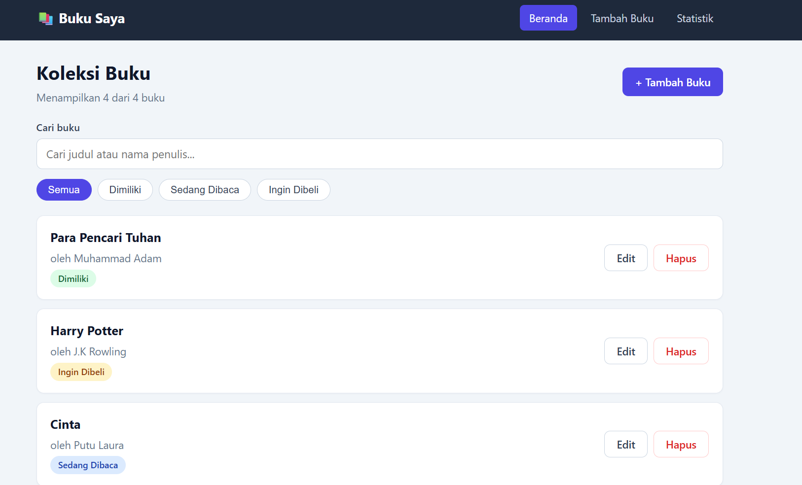
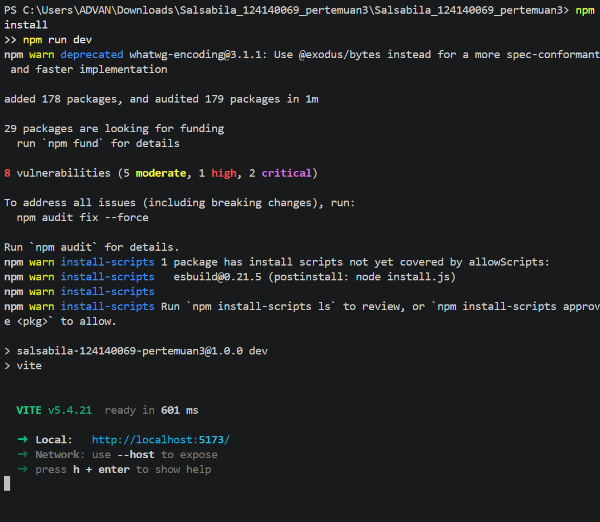

# 📚 Buku Saya — Aplikasi Manajemen Buku Pribadi

Tugas Pertemuan 3 — Pengembangan Aplikasi Web (React)

| | |
|---|---|
| **Nama** | Salsabila |
| **NIM** | 124140069 |

## Deskripsi Aplikasi

**Buku Saya** adalah aplikasi web untuk mencatat koleksi buku pribadi. Setiap buku punya
**judul**, **penulis**, dan **status**:

- **Dimiliki** (`milik`) — buku yang sudah dimiliki
- **Sedang Dibaca** (`baca`) — buku yang sedang dibaca
- **Ingin Dibeli** (`beli`) — daftar keinginan

Data tersimpan di `localStorage` browser sehingga tidak hilang saat halaman di-refresh.

### Fitur

- ➕ Menambah buku baru (judul, penulis, status)
- ✏️ Mengedit buku dan 🗑️ menghapus buku (dengan dialog konfirmasi)
- 🔎 Pencarian berdasarkan judul **atau** nama penulis (tidak peka huruf besar/kecil)
- 🏷️ Filter berdasarkan status (Semua / Dimiliki / Sedang Dibaca / Ingin Dibeli)
- 📊 Halaman statistik: total buku, jumlah penulis berbeda, dan jumlah + persentase per status
- ✅ Validasi form: kolom wajib diisi, border merah + pesan error jika kosong (spasi saja juga ditolak)

## Instalasi dan Cara Menjalankan

Prasyarat: **Node.js 18+** dan npm.

```bash
# 1. Masuk ke folder project
cd Salsabila_124140069_pertemuan3

# 2. Pasang semua dependensi (react-router-dom, prop-types, vitest, RTL, dll. sudah ada di package.json)
npm install

# 3. Jalankan aplikasi (development)
npm run dev
# buka alamat yang tampil di terminal, biasanya http://localhost:5173

# 4. Jalankan unit test
npm test

# (opsional) build produksi
npm run build
```

> Project ini dibuat dengan struktur Vite + React. Dependensi yang sama dapat dipasang manual dengan:
> `npm install react-router-dom prop-types` dan
> `npm install -D vitest @testing-library/react @testing-library/jest-dom @testing-library/user-event jsdom`

## Screenshot Antarmuka

> Ambil screenshot setelah menjalankan `npm run dev`, simpan di `docs/screenshots/`, lalu pastikan nama file sesuai di bawah.

| Halaman | Screenshot |

| Halaman Utama |  |


## Struktur Folder

```
src/
├── components/            # Komponen reusable (masing-masing + file CSS)
│   ├── BookForm/          # Form tambah/edit + validasi
│   ├── BookList/          # Daftar buku + tampilan kosong
│   ├── BookItem/          # Satu kartu buku
│   ├── BookFilter/        # Pencarian + tombol filter status
│   ├── StatusBadge/       # Label status berwarna
│   └── Navbar/            # Navigasi antar halaman
├── pages/
│   ├── Home/              # Beranda
│   ├── BookFormPage/      # Halaman /tambah dan /edit/:id
│   ├── Stats/             # Statistik
│   └── NotFound/          # Halaman 404
├── hooks/
│   ├── useLocalStorage.js # Custom hook #1
│   └── useBookStats.js    # Custom hook #2
├── context/
│   └── BookContext.jsx    # Context API (state + CRUD + filter)
├── utils/                 # constants, validateBook, bookShape (PropTypes)
├── test/setup.js          # Setup Vitest + jest-dom
├── App.jsx                # Definisi rute
└── main.jsx               # Entry point
```

## Penjelasan Fitur React yang Digunakan

| Konsep | Di mana dipakai | Penjelasan |
|---|---|---|
| **useState** | `BookForm`, `BookContext`, `useLocalStorage` | Menyimpan nilai form, error, filter status, kata kunci pencarian, dan data buku. |
| **useEffect** | `useLocalStorage` | Menyimpan data ke `localStorage` setiap kali nilainya berubah. |
| **useMemo / useCallback** | `BookContext`, `useBookStats` | `filteredBooks` dan statistik hanya dihitung ulang bila datanya berubah; fungsi CRUD dibuat stabil. |
| **Context API** | `context/BookContext.jsx` | `BookProvider` membagikan `books`, `filteredBooks`, filter, dan fungsi `addBook / updateBook / deleteBook` ke semua komponen lewat hook `useBooks()` — tanpa prop drilling. |
| **React Router v6** | `App.jsx`, `Navbar`, `BookFormPage` | Rute `/`, `/tambah`, `/edit/:id`, `/statistik`, dan `*` (404). `useParams`, `useNavigate`, `NavLink`, dan `Link` dipakai untuk navigasi. |
| **Custom hooks** | `hooks/` | `useLocalStorage` (state persisten) dan `useBookStats` (total, jumlah & persentase per status, penulis unik). |
| **Komponen reusable** | `components/` | `BookForm` (dipakai untuk tambah **dan** edit), `BookList`, `BookItem`, `BookFilter`, `StatusBadge`, `Navbar`. |
| **PropTypes** | Semua komponen | Tipe props divalidasi; bentuk objek buku dibagi lewat `bookShape`. |
| **Error handling form** | `BookForm`, `utils/validateBook.js` | Validasi judul, penulis, dan status; kolom bermasalah diberi class `input--error` (merah) dan pesan `role="alert"`; error hilang saat pengguna mengetik. |
| **localStorage** | `useLocalStorage` | Data buku persisten, dengan `try/catch` bila data rusak atau storage tidak tersedia. |

## Unit Test

Test memakai **Vitest + React Testing Library** (`@testing-library/jest-dom`, `user-event`).
Jalankan dengan `npm test`.

| File | Yang diuji |
|---|---|
| `hooks/useLocalStorage.test.js` | Nilai awal, membaca data tersimpan, menyimpan perubahan |
| `hooks/useBookStats.test.js` | Total, hitungan & persentase per status, penulis unik, daftar kosong |
| `components/BookForm/BookForm.test.jsx` | Error saat kosong, submit valid, error hilang saat mengetik, input spasi |
| `components/BookFilter/BookFilter.test.jsx` | Klik filter, status aktif, input pencarian |
| `components/BookList/BookList.test.jsx` | Render daftar, tampilan kosong, tombol edit/hapus |
| `App.test.jsx` | Integrasi: cari, filter, tambah, edit, hapus (+ batal), halaman statistik |

Total: **23 test case** di 6 file.

### Laporan Testing

> Jalankan `npm test`, lalu ambil screenshot hasil di terminal dan simpan sebagai
> `docs/screenshots/test-result.png`.



## Catatan Kode

Bagian-bagian penting diberi komentar langsung di kode, terutama `BookContext.jsx`
(CRUD dan logika filter), `useLocalStorage.js`, `useBookStats.js`, `BookForm.jsx` (validasi),
dan `validateBook.js`.
